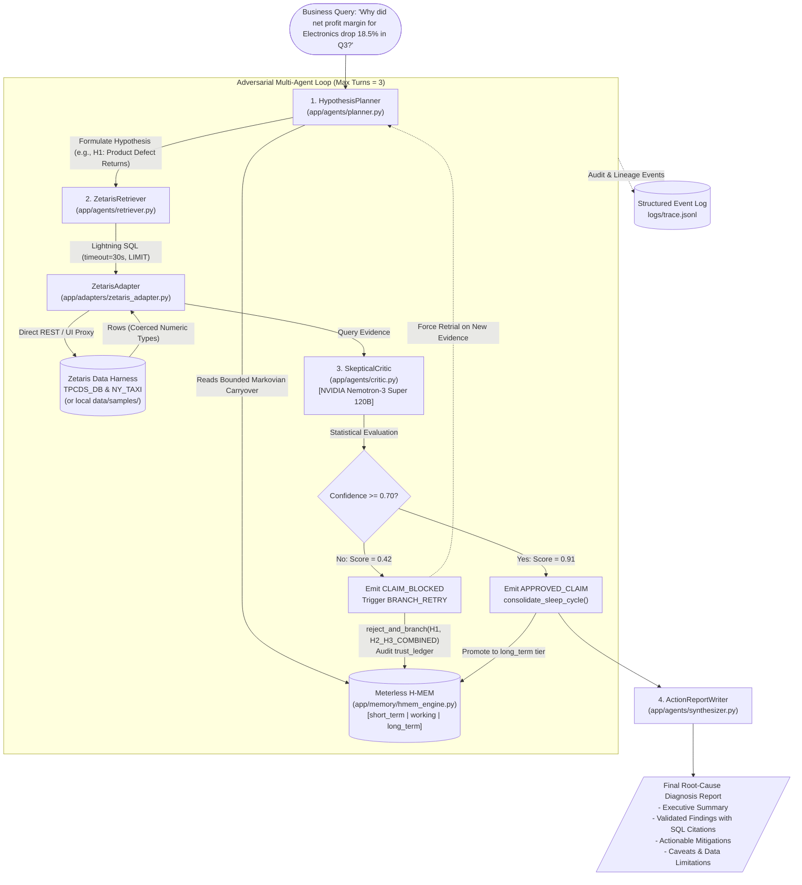

# MarginWhy: Multi-Agent Root-Cause Investigation for Retail Profit Drops & Operational Disruptions

[](https://hackathon.genai.works/event/open-agent-hackathon-2026)
[](https://hackathon.genai.works/event/open-agent-hackathon-2026)
[]()
[](https://catalog.ngc.nvidia.com/)
[](https://github.com/zetaris/getting-started)
[](https://github.com/Meterless/H-MEM)
[](LICENSE)

---

## 1. Executive Summary & Problem Statement

In modern omnichannel retail operations, root-cause analysis of sudden profit margin collapse is hindered by fragmented, silod data across physical stores (`store_sales`), e-commerce platforms (`web_sales`), returns history (`web_returns`, `catalog_returns`), distribution inventories (`inventory`), and municipal logistics networks (`NY_TAXI`).

When net profit margin for a flagship business unit drops abruptly (e.g., **Electronics net profit margin falls 18.5% in Q3**), human merchandisers and operations directors spend days writing manual ad-hoc SQL or jumping to misleading conclusions based on isolated data points.

**MarginWhy** solves this via a **non-linear, multi-agent adversarial critic loop**:
1. It decomposes business queries into testable, orthogonal hypotheses ($H_1, H_2, H_3$).
2. It queries cross-silo data sources via **Zetaris Lightning SQL**.
3. It subjects all preliminary findings to a **SkepticalCritic** running on **NVIDIA Nemotron-3 Super 120B**. Weak hypotheses ($confidence < 0.70$) are blocked with `CLAIM_BLOCKED` events, stored in **Meterless H-MEM**, and forcefully branched into multi-source investigations.
4. It outputs an executive-ready, evidence-backed root-cause diagnosis citing exact table names and quantitative metrics, accompanied by operational action items and explicit caveats.

---

## 2. System Architecture: The Non-Linear Critic Loop

Unlike traditional linear pipelines that hallucinate or accept the first correlation found, **MarginWhy** enforces strict iterative verification:



### The 4 Specialized Agents

| Agent | Module | Core Functionality & Technical Boundary |
| :--- | :--- | :--- |
| **`HypothesisPlanner`** | `app/agents/planner.py` | Analyzes operator inquiries, reads prior refuted hypotheses from `H-MEM` Markovian carryover to avoid duplicate loops, and delegates SQL queries dynamically. |
| **`ZetarisRetriever`** | `app/agents/retriever.py` | Compiles natural hypotheses into dialect-compliant Lightning SQL with mandatory `LIMIT`, enforces 30s timeouts, retries twice on transient network faults, and seamlessly falls back to `data/samples/`. |
| **`SkepticalCritic`** | `app/agents/critic.py` | Acts as an unyielding auditor powered by `nvidia/nemotron-3-super-120b-a12b`. Scores statistical causality ($0.0 - 1.0$). If $confidence < 0.70$, issues `CLAIM_BLOCKED` + `BRANCH_RETRY` and permanently blacklists the hypothesis. |
| **`ActionReportWriter`** | `app/agents/synthesizer.py` | Ingests **only** Critic-approved claims (`APPROVED_CLAIM`), formatting findings with exact data citations, estimated financial impact, recommended corrective actions, and explicit data limitation boundaries. |

---

## 3. Mandatory Sponsor Technology Integrations

### 1. Zetaris AI Data Harness & Lightning SQL
* **Implementation:** `app/adapters/zetaris_adapter.py`
* **Supported Protocols:** Direct REST API (`/api/v1.0`), UI Proxy Helper (`/api/proxy/query`), and JDBC.
* **Dialect:** Lightning SQL queries across `TPCDS_DB` (`web_returns`, `inventory`, `web_sales`, `customer_address`) and `NY_TAXI` (`taxi_zones`, `trip_data`).
* **Production Resilience:**
  - Robust string-to-float type coercion (`_coerce_numeric_row`) overcoming Zetaris REST string-serialized numerics.
  - Strict 30s connection timeouts with dual-attempt auto-retry.
  - Full local fallback to `data/samples/*.json` when `SAMPLE_MODE=true` is enabled for judge evaluation.

### 2. Meterless H-MEM (Hierarchical Memory & Markovian Carryover)
* **Implementation:** `app/memory/hmem_engine.py` & `tests/test_hmem_conformance.py`
* **Architecture:** 3-Tier Living Knowledge Graph:
  - `short_term` (Episodic): SQL statement history, query IDs, and raw record batches.
  - `working` (Semantic): Active hypotheses, confidence scores, and critic dispute logs.
  - `long_term` (Procedural): Consolidated domain rules and permanently refuted hypotheses.
* **Compliance:**
  - Strict 8-field record schema (`id`, `tier`, `content`, `source`, `confidence`, `provenance`, `entities`, `relationships`, `replacement_lineage`).
  - Immutable audit trail (`trust_ledger`) recording all `MINE`, `CLAIM_BLOCKED_LINEAGE`, and `CONSOLIDATE` events.
  - **Markovian Bounded Carryover:** Compresses state so agents never reload bloated transcript tokens across loop turns.

### 3. Meterless Nightshift & NVIDIA Nemotron
* **Implementation:** `app/llm/nightshift_client.py`
* **Target Model:** `nvidia/nemotron-3-super-120b-a12b` (configured via `METERLESS_BASE_URL` using OpenAI Python SDK).
* **Structured Tracing:** Every inference event in `logs/trace.jsonl` contains `"model": "nvidia/nemotron-3-super-120b-a12b"`.
* **Zero-Dependency Fallback:** Built-in deterministic reasoning engine ensuring 100% completion during offline judge evaluation.

### 4. Cursor Developer Story
* Developed collaboratively using **Cursor IDE** (Composer & Agentic workflows) following best-in-class prompt engineering patterns and automated test generation.
* Specification declared in `metadata.json` for the **Cursor Developer Award**.

---

## 4. Quick Start (Clean Clone in < 60 Seconds)

### Prerequisites
* Python 3.10+
* Virtual environment (`venv` or `conda`)

### Step 1: Clone & Setup
```bash
git clone https://github.com/Gold2k2k2k/MarginWhy-A-Multi-Agent-System-for-Investigating-Profit-Margin-Drops-Operational-Disruptions.git
cd MarginWhy-A-Multi-Agent-System-for-Investigating-Profit-Margin-Drops-Operational-Disruptions

python -m venv .venv
# Windows:
.venv\Scripts\activate
# Linux/macOS:
source .venv/bin/activate

pip install -r requirements.txt
```

### Step 2: Environment Configuration
Copy the template configuration (no real API keys required for offline demo):
```bash
cp .env.example .env
```

### Step 3: Run the System (Offline Sample Mode)
Execute the complete multi-agent investigation in under 60 seconds with zero external dependencies:
```bash
python run.py --query "Why did net profit margin for Electronics drop 18.5% in Q3?" --sample-mode
```

Alternatively, run directly from a packaged scenario bundle:
```bash
python run.py --input data/samples/scenario_1_electronics_q3.json --sample-mode
```

### Step 4: Launch Web Dashboard (Optional)
```bash
uvicorn app.main:app --host 0.0.0.0 --port 8000 --reload
```
Navigate to `http://localhost:8000` to visualize the live agent debate and memory state graph.

---

## 5. Verification & Conformance Checklist

Run the automated verification suite to validate system integrity:

```bash
# 1. Run H-MEM Conformance Test Suite
pytest tests/test_hmem_conformance.py -v

# 2. Verify Structured JSONL Audit Trace
python -c '
import json
with open("logs/trace.jsonl", "r", encoding="utf-8") as f:
    events = [json.loads(line) for line in f if line.strip()]
assert any(e.get("event") == "CLAIM_BLOCKED" for e in events), "Missing CLAIM_BLOCKED event!"
assert any("nemotron" in str(e.get("model", "")).lower() for e in events), "Missing NVIDIA Nemotron model tag!"
print(">>> Trace verification PASSED. Total events:", len(events))
'

# 3. Security Check (Ensure zero leaked credentials)
git status --ignored
```

---

## 6. Repository Layout

```text
├── run.py                          # Unified CLI entry point (--query, --input, --sample-mode)
├── app/
│   ├── main.py                     # FastAPI application & Interactive UI dashboard
│   ├── adapters/
│   │   └── zetaris_adapter.py      # Zetaris REST/Lightning SQL adapter + sample fallback
│   ├── memory/
│   │   └── hmem_engine.py          # Meterless H-MEM hierarchical memory & trust ledger
│   ├── llm/
│   │   └── nightshift_client.py    # Meterless Nightshift -> NVIDIA Nemotron-3 Super 120B
│   └── agents/
│       ├── orchestrator.py         # Iterative critic loop controller (max turns: 3)
│       ├── planner.py              # HypothesisPlanner (decomposes query, checks H-MEM)
│       ├── retriever.py            # ZetarisRetriever (generates safe Lightning SQL)
│       ├── critic.py               # SkepticalCritic (evaluates confidence, blocks weak claims)
│       └── synthesizer.py         # ActionReportWriter (compiles verified root cause)
├── data/
│   └── samples/                    # 3 benchmark scenario datasets
│       ├── scenario_1_electronics_q3.json
│       ├── scenario_2_apparel_returns.json
│       └── scenario_3_shipping_delay.json
├── logs/
│   └── trace.jsonl                 # Structured event trace log (JSON Lines)
├── tests/
│   └── test_hmem_conformance.py    # Pytest H-MEM conformance & rejection branching tests
├── .env.example                    # Environment variable template
├── .gitignore                      # Git exclusion rules (protects credentials)
├── metadata.json                   # Hackathon submission manifest & Cursor workflow details
├── requirements.txt                # Production dependencies
└── README.md                       # Project documentation & benchmark guide
```

---

## 7. Submission Details & Team Light of Numbers

* **Event:** Open Agent Hackathon 2026 (GenAI.Works & GenAI Academy)
* **Team:** Light of Numbers
* **Target Tracks:**
  - Track 02: *The Agent That Can Explain Why*
  - Best Use of NVIDIA Nemotron
  - Cursor Developer Award
* **Repository:** [https://github.com/Gold2k2k2k/MarginWhy-A-Multi-Agent-System-for-Investigating-Profit-Margin-Drops-Operational-Disruptions](https://github.com/Gold2k2k2k/MarginWhy-A-Multi-Agent-System-for-Investigating-Profit-Margin-Drops-Operational-Disruptions)
